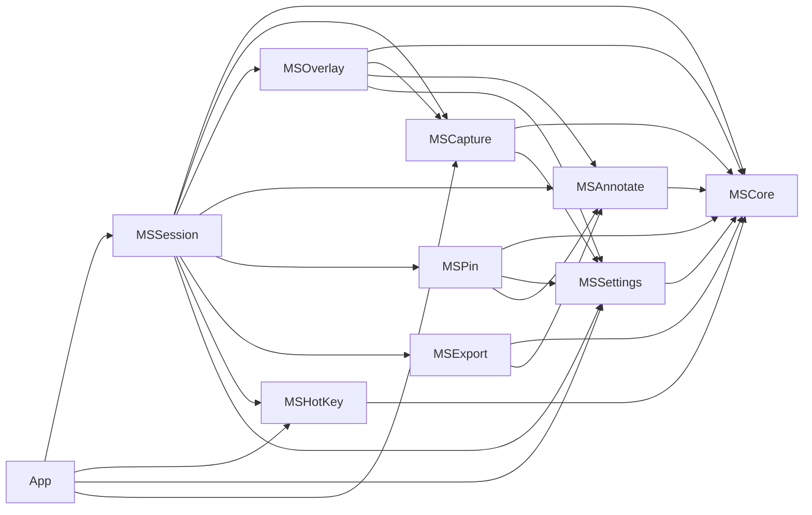

# 模块清单与边界

> 真源：**每个模块的职责与公开 API 面**以本文为准；依赖方向与命名以 `docs/charter.md` §4 为准（ADR-012）。
> 本文的签名是**设计草图**，不是已存在代码。仓库当前无源码；`git stash@{0}` 里的骨架写于裁决前，不得作为 API 依据。

## 0. 位置与规则

| 目录 | 内容 | 规则 |
|---|---|---|
| `App/` | `main.swift`、`AppDelegate`、`AppContext`、资源、`Config/Info.plist` | 只做装配与生命周期；不放业务逻辑；唯一允许 new 具体实现的地方 |
| `Packages/MacShotKit/Sources/<Module>/` | 10 个模块 | 只依赖下游；不读 `UserDefaults` 之外的全局状态；不开新进程 |
| `Packages/MacShotKit/Tests/<Module>Tests/` | 单测 | 每模块一个 test target；无权限依赖的测试必须能在无头环境跑 |

公开 API 面纪律：`public` 只在被别的模块用到时才出现；跨模块共用类型必须下沉到 `MSCore`；禁止 `@_exported import`。

---

## 1. MSCore —— 地基（无 UI、无外部依赖）

职责：坐标与几何、图像容器、采样、日志、错误、时钟与协议外壳。

```swift
public struct MSIntPoint / MSIntSize / MSIntRect          // 像素空间整数几何（y 向下）
public struct MSDisplay: Equatable, Sendable               // 显示器逻辑帧 + scale + isMain
public enum   MSDisplays { static func current() -> [MSDisplay]; static func display(under:) -> MSDisplay? }
public extension MSDisplay { func pixelRect(forLogical: CGRect) -> MSIntRect? }   // ADR-013 唯一换算入口
public enum   MSSelectionGeometry { handle(at:of:) ; resized(by:handle:from:clampTo:lockedAspect:) ; moved ; snap ; clamp }
public struct MSCaptureFrame { image: CGImage; scale: CGFloat; display: MSDisplay?; sourcePixelRect: MSIntRect? }
public struct MSPixelColor / MSImageSampler / MSBitmap      // 放大镜取色用（P1，但类型先定）
public enum   MSError { case capture(CaptureFailure), export(ExportFailure), … }   // 带 userTextKey
public enum   MSLog { static func info(_: Category, _ : String) }                  // 不含像素内容
public protocol MSClock, MSPasteboardWriting, MSFileWriting, ScreenCapturing       // 外部世界薄封装
```

禁止：`import` 任何同级模块；出现 `NSWindow`/`NSView`；自己读 `UserDefaults`。

测试接缝：几何/换算/采样全用例（无头，`swift test`）。对应 FR-CAP-004、FR-CAP-003、NFR 正确性类。

## 2. MSSettings —— 偏好与默认值

职责：单一 `AppPreferences` 值类型（Codable + `schemaVersion`）读写 `UserDefaults`，字段只增不改语义（FR-SET-003）。

```swift
public struct AppPreferences: Codable, Sendable, Equatable {
  public var schemaVersion: Int
  public var hotkeys: HotKeyBindings          // snip / pinClipboard / snipFullscreen …
  public var export: ExportPreferences        // 目录(安全书签字符串)、命名模板、格式、质量
  public var commitBehavior: CommitBehavior   // 自动复制 / 需显式 ⌘C（Q-05）
  public var appearance: AppearanceMode       // system / light / dark
  public var annotationDefaults: AnnotationStyleDefaults   // 工具默认样式（FR-ANN-003）
}
public protocol PreferencesReading { var current: AppPreferences { get }; func updates: AsyncStream<AppPreferences> }
public final class SettingsStore: PreferencesReading { … }
```

禁止：模块内出现 `NSApplication`；用零散字符串 key 直接读写（必须走 `AppPreferences` 路径）。
测试：默认值表与 `docs/requirements/requirements.md#FR-SET-003` 表格逐字段比对。

## 3. MSHotKey —— 全局热键

```swift
public struct HotKeyCombo: Hashable, Sendable { keyCode: UInt32, modifiers: ModifierMask }
public protocol HotKeyServing {
  @discardableResult func register(_ combo: HotKeyCombo, id: HotKeyID, handler: @escaping @Sendable () -> Void) -> RegistrationResult
  func unregister(_ id: HotKeyID)
  var conflicts: Set<HotKeyID> { get }
}
public enum RegistrationResult { case ok, alreadyTaken, unsupported }   // ADR-010
```

实现：Carbon `RegisterEventHotKey`（ADR-010，`proposed`）。禁止：`CGEventTap`（要辅助功能权限 + 全局延迟，ADR-010 已否决理由）。
测试：combo 的序列化/展示文本、冲突状态机（用假服务）；真实注册只能在实拍里验（`docs/protocol/verification.md`）。

## 4. MSCapture —— 采集

```swift
public protocol ScreenCapturing: Sendable {                 // 由 MSCore 定义、本模块实现
  func freeze(display: MSDisplay) async throws -> MSCaptureFrame
  func captureFullDisplay(_ display: MSDisplay) async throws -> MSCaptureFrame
}
public enum RegionCropper { static func crop(_ frame: MSCaptureFrame, logicalSelection: CGRect, in display: MSDisplay) -> MSCaptureFrame? }
public struct CaptureBackendSelector { /* SCK vs CG 兜底，ADR-007 */ }
public struct PermissionProbe { func preflightScreenCapture() -> PermissionState }   // 版本可用性待实测
```

禁止：任何 UI/窗口；会话期重复抓屏（冻结语义要求一次，ADR-008）；直接返回 `NSImage`。
测试：注入假 `ScreenCapturing`（像素测试卡）验 FR-CAP-004 的无 ±1px、无渗色。

## 5. MSOverlay —— 遮罩与选区

```swift
public struct OverlayState { selection: MSIntRect? /* 会话内部用逻辑 CGRect，边界见 screens.md#UI-001 */ ; phase; loupe }
public final class OverlayWindow: NSWindow          // borderless、覆盖单显示器、ignoresMouseEvents=false
public final class OverlayView: NSView              // 画冻结帧 + 四块遮罩 + 选区框 + 把手 + 读数
public protocol OverlayDelegate { func overlay(_ o: OverlayWindow, didChange selection: CGRect)
                                  func overlay(_ o: OverlayWindow, didCommit intent: CommitIntent) }
public struct OverlayPointerRouter { /* 命中 → 拖拽 → 更新，全部委托 MSSelectionGeometry */ }
```

禁止：自己写几何（必须调 `MSSelectionGeometry`）；在 `draw` 里回源屏幕；重绘整屏（只画脏区）。
测试：`OverlayPointerRouter` 的事件序列 → 选区结果（纯逻辑，喂 NSEvent 等价物）。

## 6. MSAnnotate —— 标注文档与渲染（无窗口）

```swift
public struct AnnotationDocument: Codable, Sendable { schemaVersion: Int; canvasSize: MSIntSize; elements: [Element]; currentStyle: Style }
public struct Element: Identifiable, Codable { id; kind: Kind; points: [MSIntPoint]; style: Style; zIndex: Int; text: String }
public enum Kind { rect ellipse line arrow polyline freehand text badge blur spotlight crop }   // 集合待 Q-03
public enum AnnotationGeometry { bounds(of:) ; hitTest(_:element:tolerance:) ; handles(of:) ; scaled(_:factor:) }
public protocol AnnotationRendering { func render(_ doc: AnnotationDocument, source: CGImage?, scale: CGFloat,
                                                   canvasSize: MSIntSize, intent: RenderIntent) -> CGImage }
public enum RenderIntent { case preview, export, pin }   // 见 annotate-model.md §5
public struct AnnotationHistory { /* 命令式 + 拖拽合并，ADR-011 */ }
public final class TextToolController { /* 输入框宿主协议，具体 NSTextView 由上层给 */ }
```

禁止：`import` MSPin/MSOverlay；持有 `NSWindow`；把文字烘焙成位图后再也不可编辑（FR-ANN-007）。
测试：schema 往返（JSON 稳定序）、bounds/命中表、撤销合并、渲染基线图逐像素比对。

## 7. MSPin —— 贴图

```swift
public struct PinContent: Sendable { case document(AnnotationDocument, scale: CGFloat) ; case image(CGImage, scale: CGFloat) }  // D-04
public final class PinWindow: NSPanel     // nonactivating、canJoinAllSpaces、level 见 ADR-019
public final class PinViewController      // 宿主 view：位图 + 标注层绘制 + 缩放变换
public protocol PinDelegate { func pin(_ p: PinWindow, didRequestEdit doc: Binding<AnnotationDocument>)
                              func pin(_ p: PinWindow, didRequest action: PinAction) }   // copy/save/close/…
public struct PinRegistry { /* 全部贴图：计数、关闭全部（FR-SET-001 菜单项） */ }
public struct PinZoom / PinOpacity / PinMove  // 数值规则见 screens.md#UI-003
```

禁止：贴图内自己实现一套渲染（必须复用 `AnnotationRendering`）；调用 `makeKeyAndOrderFront` 抢焦点（FR-PIN-004）。
测试：`PinContent` → 视图变换矩阵；缩放档位；`PinRegistry` 生命周期。

## 8. MSExport —— 输出

```swift
public struct BitmapBaker { func bake(_ doc: AnnotationDocument, source: CGImage, scale: CGFloat) -> CGImage }  // 走 AnnotationRendering(intent: .export)
public struct ClipboardWriter { func write(_ image: CGImage, scale: CGFloat, representations: [Repr]) throws }     // ADR-014
public struct FileExporter { func save(_ image: CGImage, naming: NamingTemplate, to directory: URL, format: Format) async throws -> URL }
public struct NamingTemplate { /* $year $month $day $time $width $height $index */ }
public struct DPIWriter { /* PNG pHYs / TIFF Resolution，FR-EXP-004 */ }
```

禁止：改动文档（导出是单向烘焙，charter §1.1 对策 3）；在主线程做编码；临时文件残留。
测试：命名模板展开、DPI 往返读回、剪贴板表示集合（用假 `MSPasteboardWriting`）。

## 9. MSSession —— 编排（状态机）

```swift
public enum Phase { idle, frozen, selecting, editing, committing, failed }
public enum Event { case hotkey(HotKeyID), displayChosen, dragBegan/changed/ended, selectionChanged(CGRect)
                    case toolSelected(Kind), elementCommitted(Element), key(Shortcut), cancel, commit(CommitIntent) }
public struct Effect { case showOverlay, closeOverlay, freeze(display:), openPin(PinContent), copyToClipboard, saveAs, announce(String) }
public struct CaptureSession { mutating func handle(_ event: Event) -> [Effect] }   // 纯 reduce
public final class SessionCoordinator: OverlayDelegate, PinDelegate { /* 执行 Effect */ }
```

禁止：把状态判断散进 AppKit 事件回调（必须走 `handle(_:)`）；一个会话里并发两个提交。
测试：ST-001…ST-004 全迁移表（`docs/design/state-machines.md`），无头跑。

## 10. App/ —— 组合根

只有：`main.swift`、`AppDelegate`、`AppContext`（构造并注入各服务）、`MainMenu` 菜单构造、`Config/Info.plist` 与 entitlements、资源目录。
禁止：几何、渲染、状态机、任何 `if #available` 的采集分支。

---

## 11. 依赖图（可机检的形式）



`make check` 应包含一条"依赖方向静态检查"（解析各模块 `import`，与上图比对），列为 `T-0xx`，实现要求见 `docs/protocol/coding-conventions.md` §7。

## 12. 与 `stash@{0}` 骨架的差异（提醒，不是任务）

那份骨架的模块划分与本文一致（Core/Settings/HotKey/Capture/Overlay/Annotate/Pin/Export/Session/TestSupport），但：
1. 它的 `MSAnnotationDocument` 没有 `schemaVersion`（违 D-04 + ADR-009）。
2. 它把 `MSPin` 的 `PinContent` 定为位图（违 D-04）。
3. 它的 `MSAnnotate` 里 `MSArcColor` 等命名与本文不同源。
恢复它之前必须逐条对照 accepted ADR 改；否则按本文重写。
