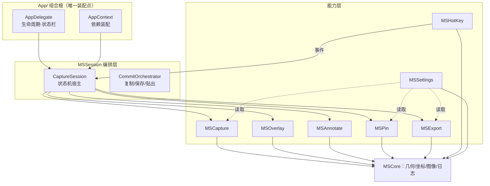
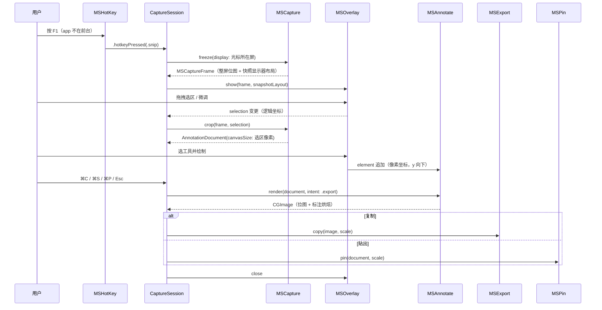

# 技术架构总览

> 派生文档：范围与命名服从 `docs/charter.md`，决策正文服从 `docs/adr/`（本文只讲机制，不重开决策）。
> 状态：**待裁决**。所有涉及未 accepted ADR 的地方标注 ADR 编号。

## 1. 进程与窗口模型

单进程、`LSUIElement`（无 Dock 图标）、非沙盒（D-02）。一个进程同时持有：

| 窗 | 类型 | 数量 | 生命周期 | 关键约束 |
|---|---|---|---|---|
| 遮罩窗 | `OverlayWindow`（borderless，全屏） | ≤1/显示器，会话期只激活一个 | 一次截取会话 | 不能抢前台；必须画在冻结帧之上（ADR-008） |
| 贴图窗 | `PinWindow`（`NSPanel` nonactivating） | 0…N | 用户关闭或退出 app | 跨 Space、全屏 App 之上、不夺焦点（FR-PIN-001/004） |
| 设置窗 | `SettingsWindow` | 0…1 | 打开到关闭 | 唯一允许 SwiftUI 的地方（ADR-002） |
| 权限引导窗 | `PermissionGateWindow` | 0…1 | 检测到缺权限时 | 见 FR-CAP-006 |

菜单栏项由 `NSStatusItem` 提供，是唯一的常驻 UI。

## 2. 分层

依赖方向单向向下（章程 §4）。`MSSession` 不认识 `App/`，`App/` 只负责把它接起来。

## 3. 一次典型会话（数据流）

要点：
- **冻结优先**：热键响应的第一步就是抓整屏，之后选区只从这张位图里裁（ADR-008）。
- **一次采集，多次裁剪**：会话期间不再回源屏幕，所以 FR-CAP-001 与 FR-SESS-004 同时成立。
- **导出走烘焙、贴图走文档**：两条路共用同一个渲染器，但输出物不同（`intent` 参数，见 `docs/architecture/annotate-model.md` §5）。

## 4. 线程与并发模型

| 工作 | 跑在哪 | 理由 |
|---|---|---|
| 窗口/事件/选区绘制 | 主线程 `@MainActor` | AppKit 硬性要求 |
| 屏幕抓取（整屏冻结帧） | `MSCapture` 内部专用串行队列 / actor | SCK 回调是异步的；串行避免同一屏并发抓取 |
| 标注渲染（导出/烘焙） | 后台 `Task`，输入为不可变 `Sendable` 值类型 | 大图渲染不能卡提交动画 |
| 剪贴板写入 | 主线程写入（`NSPasteboard`）但编码在后台完成 | `changeCount` 语义要求一次写完，避免"粘贴到半成品" |
| 文件保存 | 后台 `Task` + 完成回主线程 | FR-EXP-003 |
| 热键回调 | Carbon 回调 → 立即 hop 到主线程 | 回调上下文不能碰 UI |

规则：`AnnotationDocument`、`MSCaptureFrame`、样式与几何类型全部是值类型 `Sendable`；可变状态只允许存在于 `@MainActor`  isolate 的宿主对象里，跨 actor 传递用副本不用引用。

## 5. 启动与退出序列

启动：`main.swift` → `NSApplication` → `AppDelegate.applicationDidFinishLaunching`
1. 读 `MSSettings`（含 schema 版本，失败则回退默认值并记日志）
2. 建 `MSCore` 侧的显示器布局缓存（懒更新，见 ADR-013）
3. 注册热键（`MSHotKey`），失败项进入"冲突状态"，状态栏给标记（FR-HOT-011，P1）
4. 检查屏幕录制权限（`docs/architecture/hotkey-and-permissions.md` §4）→ 缺失则显示权限引导窗（FR-CAP-006）
5. 装 `NSStatusItem` 菜单（FR-SET-001）

退出（`⌘Q` 或注销）：关闭全部贴图窗与遮罩窗 → 注销热键 → 落盘设置。**不写历史**（Q-06 推荐 A），故贴图内未导出的标注文档会丢失 → 需在 UI 上明示（`docs/design/screens.md#UI-003` 的"未导出"标记），这条是 D-04 的直接代价。

## 6. 错误与失败模型

| 失败 | 表现 | 处理 |
|---|---|---|
| 无屏幕录制权限 | 冻结帧全黑或仅壁纸 | 会话不进入 `frozen`，弹权限引导窗；日志 `capture.perm-missing` |
| 采集返回 nil / 尺寸与快照不符 | — | 会话取消 + 一次性提示；**不做静默重试**（避免用户以为截成功了） |
| 显示器在会话中被拔掉 | 快照布局与当前屏不一致 | 按旧快照出图（FR-SESS-004），日志 `capture.display-snapshot-stale` |
| 标注文档 schema 版本不认识 | 打开 `.macshot` | 拒绝并提示（D-04 对策 2；M1 后生效） |
| 剪贴板被其他 app 抢占 | 写入失败 | 重试 1 次 → 报错提示，不静默 |
| 导出目录不可用（卷被卸载） | `⇧⌘S` 失败 | 回落到保存面板 |

错误类型集中在 `MSCore.MSError`（分域 enum + 是否可恢复 + 用户文案 key），禁止跨模块抛裸 `AnyError`。

## 7. 可测接缝（架构级要求）

1. `ScreenCapturing` 协议：注入假采集器（给一张已知像素的测试卡）→ 像素正确性用例可在无屏幕权限环境跑。
2. `MSAnnotationRenderer`：输入（文档 + 源位图 + scale + intent）→ 输出 CGImage，纯函数，可用基线 PNG 逐像素比对。
3. `CaptureSession` 状态机：`reduce(event) -> (phase, effects)`，effects 是可断言的枚举（不直接操作窗口）。
4. `Geometry` 族（`MSCore`）：无 AppKit 依赖，可 `swift test` 覆盖。
5. `MSClock` / `MSPasteboardWriting` / `MSFileWriting` 三个薄协议包住外部世界（名字以 `modules.md` §1 为准，原稿此处写成 `Clock`/`FileSystem` 已订正），禁止在能力层直接摸 `NSPasteboard.general`。

这 5 个接缝是 M-0 的准出项：没有它们，后续 P0 判据无法在无头环境验证。

## 8. 已知架构风险

| 风险 | 影响 | 缓解 | 观察点 |
|---|---|---|---|
| 贴图持有整分辨率源位图 × N | 4K 单屏 1 张 ≈ 33MB RGBA（按 3840×2160×4 算，**待实测**） | 源位图共享 + 惰性按需解码 + 上限告警 | NFR-005 |
| 窗口 level 与全屏 Space 的关系 | 贴图可能不显示在全屏 App 上 | ADR-019 未定；先取实测再定数值 | FR-PIN-001 |
| 屏幕录制授权变更需重启进程 | 用户以为"设置完就好" | 引导窗明确"需要重启 MacShot"+ 一键重启 | FR-CAP-006 |
| 遮罩全屏窗在主显示器外的表现 | 多屏选区限制 | Q-09 推荐单屏；跨屏 P2 | NFR 兼容表 |
| 冻结帧 + 再编辑使提交路径分叉（位图 vs 文档） | 两份输出不一致 | 单一渲染器 + `intent`，加"导出即渲染"快照测试 | FR-ANN-006 |
