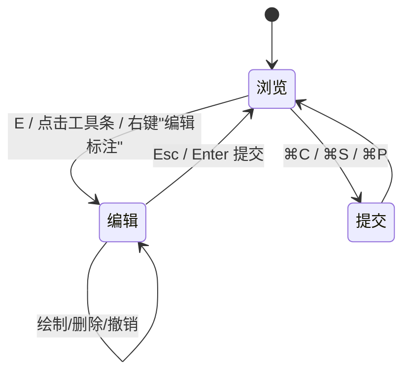

# 贴图窗（Pin）

> 机制真源：贴图窗的窗口语义、`PinContent` 模型、再编辑态、缩放与透明度、多贴图管理。
> D-04 的直接实现文档；视觉规格见 `docs/design/screens.md#UI-003`、`#UI-004`。

## 1. 窗型与窗口属性

| 项 | 取值 | 理由 |
|---|---|---|
| 类 | `NSPanel` + `[.nonactivatingPanel, .hudWindow 否]` | FR-PIN-004：出现/聚焦/关闭都不改用户输入焦点 |
| `styleMask` | `.borderless`（P0 无系统标题栏；边框属 P1 视觉件） | 贴图是内容本身 |
| `level` | **待定，ADR-019**。正确升序：`.floating`(3) = `.tornOffMenu`(3) < `.modalPanel`(8) < `.dock`(20) < `.mainMenu`(24) < `.statusBar`(25) < `.popUpMenu`(101) < `.screenSaver`(1000) < `CGWindowLevelForKey(.cursorWindow)`。候选值只取 `.statusBar`、`.statusBar + 1`、`.popUpMenu` 三档。**原稿把 `.modalPanel` 排在 `.mainMenu` 之后是错的。** 另需明确：能否盖住全屏 App，**主要取决于 `collectionBehavior`（`.fullScreenAuxiliary` + `.canJoinAllSpaces`），不是 level 越大越好** —— 所以必须实测（V-010），不要凭"调高 level"了事 | 判据 FR-PIN-001：要能盖在**全屏 Space 的 Safari / Keynote 演示**之上 |
| `collectionBehavior` | `[.canJoinAllSpaces, .fullScreenAuxiliary, .stationary, .ignoresCycle]` | `.fullScreenAuxiliary` 是能进入全屏 Space 的关键；`.stationary` 使其不随 Mission Control 挪动（P1 再评估副作用） |
| `hasShadow` | true（P0 默认开） | Snipaste 边框/阴影属视觉件，P1 可关 |
| `isMovableByWindowBackground` | true | FR-PIN-002"任意处拖拽"；但绘制层要能区分"拖窗"与"画标注"（编辑态下关掉） |
| `hidesOnDeactivate` | false | MacShot 无常驻前台，不能被隐藏 |
| `isOpaque` / `backgroundColor` | false / clear | 圆角与非矩形内容（P1）需要 |
| `acceptsMouseMovedEvents` | true | 悬停显示控制条（`UI-003`） |

`level` 数值不允许散落在代码里：只能是 `PinWindow.level` 单一入口 + 一条日志输出（FR-PIN-001 判据要求能读到实际值）。

## 2. `PinContent`：D-04 的接口体现

```swift
public enum PinContent: Sendable {
    case document(AnnotationDocument, source: CGImage, scale: CGFloat)   // 主路（自己截的图）
    case bitmap(CGImage, scale: CGFloat)                                 // 外来（剪贴板、拖入、P1 历史）
}
```

- `bitmap` 分支在内部**立刻**包装成 `AnnotationDocument(canvasSize: 图像尺寸, elements: [], sourceRef: nil)`，所以渲染路径只有一条（避免出现"两套贴图绘制"，`annotate-model.md` §9）。
- `document` 分支的 `source` 是选区裁剪后的位图，**不是整屏冻结帧**——这是内存的第一道闸门（§7）。
- `source` 常驻内存不落地（Q-06 推荐 A），退出即失，UI 需明示（`UI-003` 的"未导出"角标）。

## 3. 视图变换与缩放（FR-PIN-003）

```
viewBounds (逻辑点) = canvasSize(px) / displayScale(base) × zoom
```

| 项 | 规则 |
|---|---|
| `zoom` | 0.05…8.0；滚轮一格 ×1.1（Snipaste 用滚轮 + `-`/`+`，官方 S1）；`⌘0` = 1.0；`⌘1` = 适应窗口（P1） |
| 缩放中心 | 指针位置（拖拽中保持指针下的文档坐标不动） |
| 位图绘制 | `interpolationQuality = .none`（近邻）。放大 >100% 时看到像素方块是**正确表现**，不是 bug |
| 标注绘制 | 与位图同一 CTM，因此矢量在 200% 依旧锐利（FR-PIN-003 判据） |
| 缩小到 <100% | 位图近邻下采样会丢细节/走样 → P0 用 `.medium` 下采样，并只在此档生效；此规则写进判据（避免"缩小变糊"被当成 bug） |
| 导出/复制 | **永远按 100% 出图**，不受当前 zoom 影响。依据只是**推断**：Snipaste 把"复制/保存未缩放原图"作为 PRO 功能（`docs/reference/snipaste-gap.md` §4），可推断其缩放属于显示态；无官方说明，故不声称"与 Snipaste 一致"，只说这是我们的实现选择 |

`⌘`+滚轮被透明度占用（§6），因此缩放用**无修饰滚轮**，`⇧`+滚轮留给"宽度约束缩放"（P1）。

## 4. 再编辑态（FR-PIN-005，D-04 的核心）



实现要点：
1. 同一个 `AnnotationDocument` 实例，**编辑态与非编辑态共享**（不是打开编辑时复制一份）。
2. 渲染器复用 `AnnotationRendering`，`intent` 从 `.pin` 切到 `.preview`；两者差异只允许是"是否画把手/工具条/网格"，不允许改变元素像素结果（`annotate-model.md` §5 要求 1）。
3. 进入编辑态时 `isMovableByWindowBackground = false`（否则拖窗与拖标注冲突），退出时恢复；`⇧` 拖拽仍可移窗（`UI-004`）。
4. 编辑态下改变**窗口尺寸** = 改变文档 `canvasSize`？不允许：P0 明确禁止在贴图内改画布尺寸（等价 Q-11 的保守面）。缩放只是显示倍率，改 `frame` 才是改尺寸，P0 只允许等比缩放显示。
5. 提交后再编辑的撤销栈归属这张贴图，退出编辑不清空（`annotate-model.md` §7）。
6. 右键菜单项"切换标注显隐"（Snipaste PRO 有，我们免费给）P1：`⇧E` 只切显示，不改文档。

## 5. 事件表（浏览态）

| 输入 | 行为 | ID |
|---|---|---|
| 左键拖 | 移动贴图 | FR-PIN-002 |
| 双击 | 关闭（P0 语义 = 销毁，Q-13 待裁决"可恢复"） | FR-PIN-002 |
| 滚轮 | 缩放 | FR-PIN-003 |
| `⌘`+滚轮 | 透明度 | FR-PIN-017 |
| `⌘C` | 复制当前内容（含标注，按 100%） | FR-EXP-002 |
| `⌘S` / `⌘⇧S` | 保存面板 / 免面板直存 | FR-EXP-003 |
| `⌘W` / `Esc` | 关闭 | FR-PIN-002 |
| `E` | 进编辑态 | FR-PIN-005 |
| `1`/`2`、`3`/`4` | 旋转/翻转 | P1 `FR-PIN-015` |
| 右键菜单 | 复制 / 保存 / 编辑 / 透明度档位 / 前置层级 / 关闭 | `UI-003` |
| 拖出贴图到别处 | P1 `FR-EXP-011` |

## 6. 透明度（FR-PIN-017）

- 范围 0.05…1.0，`⌘`+滚轮每格 ±5%，`⌘0` = 100%，`⌘9`…`⌘1` = 90%…10%。
- 实现：`window.alphaValue`（**不用**图层 alpha，否则阴影跟随异常，需实测确认）。
- 透明度不影响导出/复制结果（导出恒为 100% 不透明）。

## 7. 内存与数量上限（NFR-005 的实现侧）

粗算（**全部待实测**）：4K 整屏 = 3840×2160×4 ≈ 33MB/张；1080p@2x 选区 1/4 屏 ≈ 8MB/张。
10 张贴图若都是整屏 → 目标上限 330MB 量级，明显偏大，因此：

| 措施 | 阶段 |
|---|---|
| 只持选区位图，不持整屏帧（§2 已定） | P0 |
| 同一次会话多次贴出共享同一份 `CGImage`（值语义 + COW） | P0 |
| `CGImageSourceCreateWithDataProvider` 惰性解码（先落盘再引用） | P1（与 Q-06 绑定） |
| 贴图数 ≥ 12 时状态栏给内存提示 | P1 |
| 超阈值拒绝贴出 | **不做**（用户会认为程序坏了） |

`NFR-005` 的回退判据（`docs/charter.md` §1.1）：若"再编辑导致单张贴图常驻内存 > 位图本体 ×1.5 或拖动帧率 < 30fps（**目标值待实测**）"，则回到 Q-12 重新裁决 D-04。

## 8. 多贴图管理

```swift
public final class PinRegistry {
    func open(_ content: PinContent, at frame: CGRect?, screen: MSDisplay) -> PinWindow
    func close(_ id: PinID)
    func closeAll()                       // 菜单项（FR-SET-001）
    var count: Int
    func forEach(_ body: (PinWindow) -> Void)
}
```

- P0 不做分组、不做"隐藏/显示全部"（Snipaste 用 `⇧F3`，我们 P1 `FR-PIN-011`）。
- 贴图之间 z 序由用户点击顺序决定，`level` 一致即可。
- 退出 app 时 `closeAll()` 之前检查是否有未导出编辑（有则提示，Q-06 的代价；文案在 `UI-003`）。

> **关闭即还内存**（11-17，`E-072`）：注册表在**最后一张贴图关掉**时调 `malloc_zone_pressure_relief`，
> 因为 macOS 的 malloc 不主动交还空页——实测 10 张 4K 贴图关闭后 RSS 残留 +32.9MB（破 `NFR-008` 的 ±10%），
> 压一次回到 −5%。批次峰值不随轮次抬升（118.2 vs 120.1MB）证明那是可复用缓存，不是泄漏。

## 9. 失败与边界

| 情况 | 行为 |
|---|---|
| 剪贴板不是图片 | 热键给出一次性提示"剪贴板里没有图像"（不弹窗打断） |
| 剪贴板是超大图（>8000px） | 仍贴出，但显示倍率自动 <100%，日志给警告 |
| 贴图所在显示器被拔 | 窗口 frame 落到无效坐标 → 拉回主屏中心（用例 `V-011`） |
| 全屏 App 遮挡贴图 | 即 ADR-019 的实测失败信号，必须记 `blocked.md` 而不是悄悄降 level |
| 同时打开 100 张 | 不崩；`PinRegistry` 无硬上限（P1 加告警） |

## 10. 测试清单

1. `PinContent.bitmap` → 自动包成空文档，`canvasSize` == 图像尺寸。
2. 变换矩阵：zoom × anchor 组合下"指针下文档坐标不变"。
3. 导出恒 100%：任意 zoom 下 `BitmapBaker` 输出尺寸 == `canvasSize`。
4. 编辑态切换不改变像素结果（`.pin` 与 `.preview` 基线比对，除去 UI 层）。
5. 拖窗 vs 拖标注的互斥（编辑态下 `isMovableByWindowBackground` 必须为 false）。
6. 实拍：全屏 Safari/Keynote 之上可见、`⌘`+滚轮透明度、拔屏回落、`⇧F3` 之前的 P0 版无该功能（确认没误实现）。
