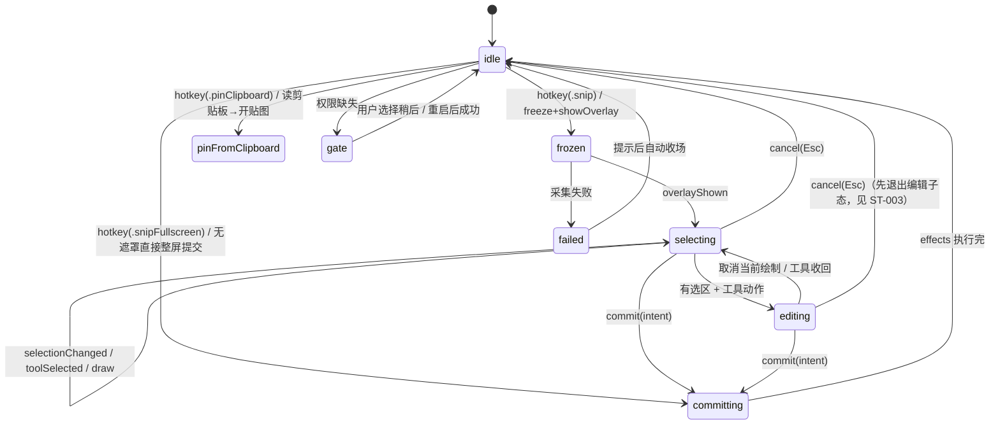

# 状态机与迁移用例

> 真源：**状态与迁移**。`MSSession.CaptureSession.reduce(event)` 的行为以本文为准；实现必须能逐行对上本文的用例表（`docs/architecture/annotate-model.md`、`overlay-and-selection.md` 只引用不另立）。

## ST-001 截取会话



| # | 当前 | 事件 | 迁移到 | Effect | 判据 |
|---|---|---|---|---|---|
| 1 | `idle` | `hotkey(.snip)` | `frozen` | `freeze(display: 光标屏)`、`showOverlay` | FR-CAP-001 |
| 2 | `idle` | `hotkey(.snip)` 且无权限 | `gate` | `showPermissionGate` | FR-CAP-006 |
| 3 | `idle` | `hotkey(.snipFullscreen)` | `committing` | `freeze`、`copy/save/pin` | FR-CAP-005 |
| 4 | `idle` | `hotkey(.pinClipboard)` + 剪贴板有图 | `idle` | `openPin(.bitmap)` | FR-PIN-006 |
| 5 | `idle` | `hotkey(.pinClipboard)` + 无图 | `idle` | `toast("剪贴板里没有图像")` | `pin-window.md` §9 |
| 6 | `frozen` | `overlayShown` | `selecting` | — | — |
| 7 | `selecting` | `selectionChanged(rect)` | `selecting` | `updateReadout`；若 `elements` 非空 → `warnClearAnnotations` | FR-CAP-002、Q-11 |
| 8 | `selecting` | `toolSelected(k)` 且无选区 | `selecting` | `toast("先框选区域")`，**不进 editing** | ST-001 非法项 |
| 9 | `selecting` | `drawBegan` 且有选区 | `editing` | `beginElement(kind)` | FR-ANN-001 |
| 10 | `editing` | `drawEnded` | `selecting` | `commitElement` → 历史合并 1 条 | FR-ANN-005 |
| 11 | `editing` | `commit(.copy)` | `committing` | `bake`、`writePasteboard`、`closeOverlay` | FR-EXP-001 |
| 12 | `editing` | `commit(.pin)` | `committing` | `openPin(.document)`、`closeOverlay`（**不写剪贴板**） | `export-clipboard.md` §5 |
| 13 | `selecting` | `cancel` | `idle` | `closeOverlay`；**无剪贴板 effect** | FR-SESS-002 |
| 14 | `committing` | `effectsDone` | `idle` | 释放会话持有的冻结帧 | — |
| 15 | 任意非 idle | `displayChanged` | 不变（用快照） | 记 `capture.display-snapshot-stale` | FR-SESS-004 |

**非法迁移（必须被拒绝并有测试）**：`idle + selectionChanged`；`frozen + commit`（无选区）；`committing + drawBegan`；一个会话并发两个 `commit`；`gate` 之外的状态收到 `permissionGranted`（应忽略并提示重启）。

## ST-002 遮罩内指针模式

```
          ┌────────────┐  press(把手)   ┌────────┐
press→    │ 待定(≤4px) │────────────────▶│ resize │──release→ 归一化/钳制 → idlePointer
          └─────┬──────┘                └────────┘
                │ press(选区内)  ┌───────┐
                ├───────────────▶│ move  │
                │ press(选区外)  └───────┘
                └───────────────▶ newSelection
有工具且 press(选区内) ─────────▶ draw  (→ ST-003)
```

判定顺序见 `docs/architecture/overlay-and-selection.md` §4。位移 <4pt 且松开 → 视为点选（P0 取消；P1 走窗口识别）。

## ST-003 标注编辑子态（含文字）

| 状态 | 进 | 出 | 注意 |
|---|---|---|---|
| `工具待落笔` | 选中工具 | 落笔 → `绘制中` | 再按同一工具键 = 取消工具（回到选择态） |
| `绘制中` | 落笔 | 抬手 → `元素已提交` | 折线：双击/`Enter` 结束，`Esc` 丢弃当前折线但不退出工具 |
| `元素选中` | 点元素 | 点空白/切工具 → `工具待落笔` 或无选中 | 把手只在选中时出现 |
| `拖拽中` | 元素选中后按下拖动 | 抬手 → 历史合并 1 条 | **一次拖拽 = 一条撤销记录**（ADR-011） |
| `文字输入` | 文字工具点画布 | `⌘Enter` → 提交；`Esc` → 放弃（无记录） | 进入时窗变 key（不 activate app）；`⇧Enter` 换行 |
| `再编辑（贴图内）` | `E` / 操作条 ✎ | `Enter`/`Esc`/`E` → 浏览 | 同一文档实例；撤销栈属于贴图（`annotate-model.md` §7） |

## ST-004 贴图生命周期

```
open → 浏览 ⇄ 编辑 → (复制/保存 → 仍浏览，清除"未导出") → close(销毁)
                         ↑ 任何导出动作
```
| 事件 | 结果 | 判据 |
|---|---|---|
| `E` | 浏览→编辑 | FR-PIN-005 |
| `⌘C` | 复制 100% 烘焙结果，"未导出"标记消失 | FR-EXP-002 |
| `⌘W`/双击 | 销毁（Q-13 待裁决是否可恢复） | FR-PIN-002 |
| 有未导出编辑时关闭 | 一次性确认（首次之后记住偏好） | `screens.md#UI-003` |
| `closeAll()` | 全部销毁 | FR-SET-001 |

## ST-005 提交意图路由

`CommitIntent` → Effect 序列的唯一表（真源在 `docs/architecture/export-clipboard.md` §5，本文只列**会话侧**顺序）：

```
commit(intent):
  1) 停输入子态（文字提交/放弃）
  2) baking（后台）
  3) 按 intent 执行：copy → writePasteboard | save → panel|quickSave | pin → openPin(document)
  4) closeOverlay（先收窗，再做耗时的事？—— 不：收窗在第 4 步，保证"提交即消失"的观感，
     耗时步骤用 intent 的完成回调决定 toast）
  5) phase = idle
```
第 4 步的顺序是刻意的：**窗先消失，导出在后台完成**。反了会让用户以为卡住（这条来自 NFR 的延迟目标，实测后若发现"提交后贴图迟迟不出现"再调）。

## ST-006 权限门

`unknown → granted | missing`；`missing → prompting（跳系统设置）→ missing（未授权回来）| restarting（重启中）`；`restarting → granted`。P0 只在启动与会话开始时评估一次，不做轮询（轮询会反复触发系统提示）。
